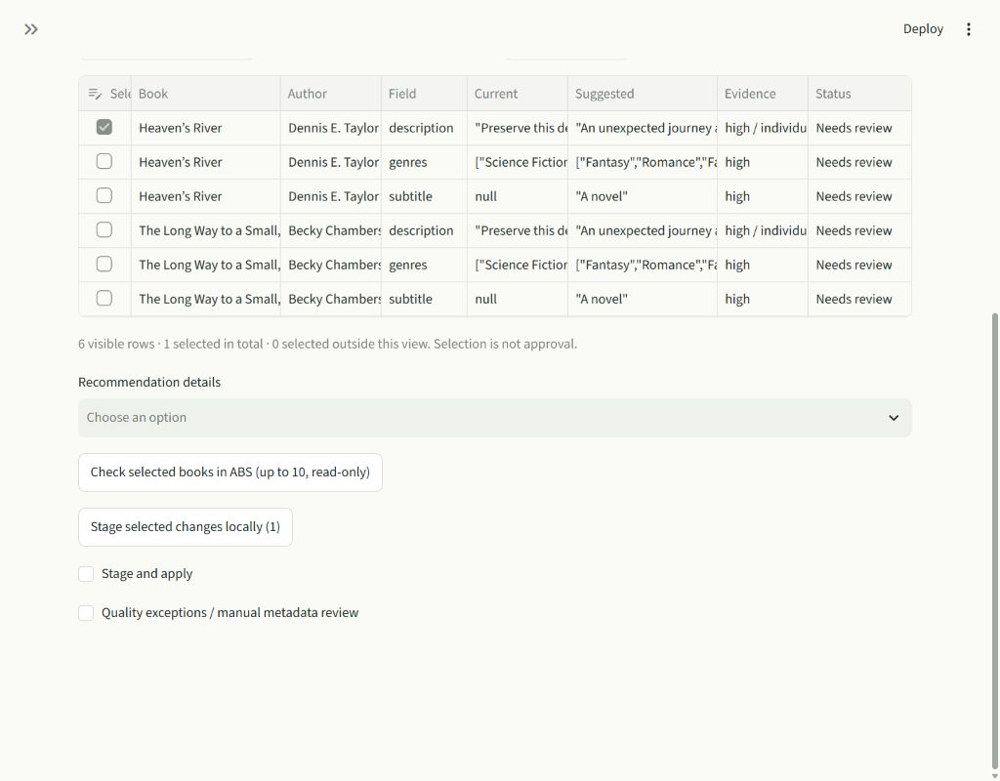
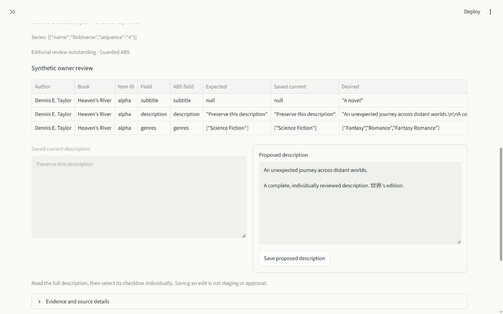

# Table-first Review workspace

## Assessment and scope

The old flow split import, evidence review and accumulated corrections across three
destinations. Its recommendation overview repeated counts, tables and a separate
multiselect. Collapsed staged editors still rendered every book. The synchronization
expander also generated a full quality report during unrelated reruns.

Review now combines AI import, a field correction table, one recommendation/book
inspector and the existing Stage and apply controls. Library holds refresh/export;
Activity holds history/recovery. Settings is unchanged. The table owns checkbox
selection; no schema, matching, authority, approval or transport code changed.
The synchronization assessment now has an explicit load control inside the read-only
observation panel. Quality assessment is also loaded deliberately.

This is the bounded first delivery allowed by the brief. Evidence-derived proposals
remain in their established Quality exceptions panel; they are not merged with the
AI upload into a second proposal engine. Typed manual editing remains there, and
the staged book inspector retains edit/discard controls. Series filtering, opening
details by clicking any table cell, and a single combined quality/correction summary
are deferred. The native detail selector preserves filters and checkbox selections.
The default summary counts pending/approved/consumed findings, while uploaded
recommendations and assessed quality retain separate counts. No independent quality
is inferred from uploaded confidence. Unsupported/blocked rows cannot be staged.

## Validation

Per the owner's testing addendum, validation used small fixtures and focused tests,
not the full suite or the existing 110/750-book demonstrations. Twenty-two distinct
tests passed across bounded runs: a 21-test focused run plus the existing exact
confirmation/apply/rollback UI test. After making synchronization assessment lazy,
the two directly affected performance/safety UI tests passed again (5.49 s).
No tests in these selected runs were skipped. The full suite, production services,
real CLI/Calibre integrations and large-library benchmarks were not run.

Coverage includes filtering/sorting, hidden selection, filtered bulk selection,
description and narrator exclusion, actual editor checkbox state, complete Unicode
description editing, local staging without approval, reimport, empty startup,
resolved and ebook-only corrections, recovery blocking, navigation without remote
traffic, separate field approval, exact confirmation, fake apply/readback and rollback.
Default Review is tested to reject any eager `verification_report` call.

Ruff across the repository, `pip check`, `start.ps1 -Check`, `git diff --check` and
the UI skill's mechanical detector passed (no detector findings). An initial
sandboxed Streamlit benchmark stalled; completed checks used normal local temp
access with isolated settings, synthetic databases and fake adapters. No production
database, credentials, metadata, provider or remote writer was accessed.

### Page-load performance

`scripts/profile_workspace.py` uses 12 synthetic books, 12 long staged descriptions
and 24 journal entries. Main at `9f51a87` and the new UI ran with the same fixture
and interpreter. Values are individual local AppTest observations, not statistical
thresholds or browser paint/network measurements. Cold startup includes Python /
Streamlit initialization and is not a like-for-like screen comparison: main opens
Import, while this version opens Review.

| Measurement | Main | Review workspace |
| --- | ---: | ---: |
| Cold app startup | 1,952 ms | 1,498 ms |
| First correction workspace navigation/rerun | 217 ms | 97 ms |
| Warm correction workspace rerun | 125 ms | 101 ms |
| Correction workspace element payload | 22,788 bytes | 13,908 bytes |
| First Activity/History navigation | 96 ms | 101 ms |
| Warm Activity/History rerun | 101 ms | 100 ms |

No live reads/writes occur during this benchmark. Initial and warm Review render
zero description editors; opening one book is required to render full text. PR #32's
summary-based journal access and bounded description previews remain intact.

### Desktop inspection

The two-book `scripts/visual_review.py` fixture supplies only synthetic input and a
fake adapter. Browser inspection verified the complete correction columns fit at
1024×800, individual description selection, selection surviving search/filter changes,
and the full side-by-side description editor at 1280×800. The page scrolls vertically;
long table values are abbreviated/clipped and remain available in detail. These are
not exhaustive keyboard, contrast or browser performance measurements.

